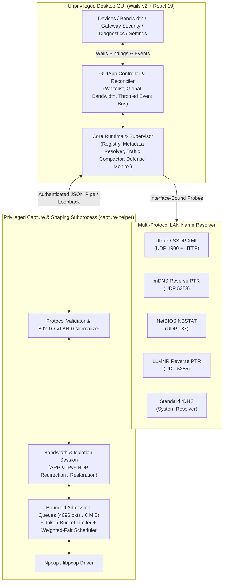

<div align="center">


# NetWarden

**Local-network device discovery, multi-protocol LAN identification, gateway-security monitoring, device whitelisting, and dual-stack bandwidth shaping for desktop.**

[](https://go.dev/)
[](https://wails.io/)
[](https://react.dev/)
[](#production-deployment--downloads)
[](./LICENSE)

</div>

---

## Overview

**NetWarden** is a native desktop application built with Go, Wails v2, and React for inspecting, protecting, and managing your local network (`IPv4` and `IPv6`). Unlike passive scanners that only show raw IP/MAC addresses or require terminal utilities, NetWarden combines active multi-protocol device naming, real-time ARP/NDP gateway integrity verification, per-device and global traffic monitoring, token-bucket bandwidth shaping, and temporary device isolation into a single low-overhead desktop dashboard.

Key engineering principles:
- **Privilege Separation**: Packet capture and narrowly validated packet transmission run inside a dedicated `capture-helper` subprocess while the GUI runs unprivileged.
- **Zero Console Spam on Windows**: Route discovery uses in-process Win32 `iphlpapi.dll` (`GetBestRoute`) and notifications use native Win32 `Shell_NotifyIconW`, never spawning background `ROUTE.EXE`, `conhost.exe`, or `powershell.exe` windows.
- **Wi-Fi & Npcap 1.81+/1.90 Compatibility**: Automatically unwraps IEEE 802.1Q `VLAN 0` (`0x8100`, VID 0) priority tags reconstructed by Npcap on Windows Wi-Fi adapters and uses station-compatible 802.3 source headers for ARP/NDP restoration.
- **Safe & Reversible Controls**: Every network control (disconnect, continuous isolation, per-device limit, global bandwidth limit, or traffic monitor) is temporary and automatically restores verified ARP and IPv6 Neighbor Discovery mappings when stopped or on application shutdown.

---

## Key Features

- **Multi-Protocol LAN Device Naming**: Resolves human-readable device names concurrently via **UPnP / SSDP** XML device descriptions (`<friendlyName>`, `<modelName>`), **mDNS / Bonjour** reverse PTR (`UDP 5353`), **NetBIOS Node Status (`NBSTAT`)** (`UDP 137`), **LLMNR** (`UDP 5355`), and standard **Reverse DNS**, with intelligent IEEE OUI vendor + device-type fallback labels.
- **Stable Discovery-Order Table & Interactive Sorting**: Defaults to chronological discovery order (`FirstSeen`) so newly discovered devices append cleanly to the bottom of the list without shifting rows under your cursor, while supporting one-click column sorting across all fields.
- **Device Whitelist Protection**: Pin trusted devices (your workstation, servers, smart TVs, or phones) to the persistent **Whitelist**. Whitelisted devices are automatically exempt from **Global Bandwidth Limits**, individual bandwidth limits, **Disconnect Selected**, and **Disconnect All**.Adding a currently limited or disconnected device to the Whitelist immediately restores its normal network access.
- **Global Bandwidth Limit & Global Traffic Monitoring**:
  - **Global Traffic Monitoring**: One-click toggle to monitor live upload/download speeds, totals, peaks, and historical usage across all online devices, automatically attaching to new devices as they join the LAN.
  - **Global Bandwidth Limit**: Configure a network-wide Download and Upload speed cap (`MB/s` or `Mbps`) that applies to all online non-whitelisted devices and automatically enforces itself on newly connected non-whitelisted peers.
- **Built-in Network Troubleshooting & Security Tools Suite (`Tools` Tab)**:
  - **Ping**: Visual RTT latency bar chart, packet loss, min/avg/max, and jitter using native in-process Win32 `IcmpSendEcho` (`iphlpapi.dll`) with TCP latency fallback.
  - **Trace Route**: Hop-by-hop router path discovery and transit delay measurement with automatic reverse DNS lookup.
  - **Wi-Fi Scanner**: Native Win32 `wlanapi.dll` BSS scanner showing nearby Wireless Access Points, SSID, BSSID, IEEE OUI vendor, RSSI (`dBm`), signal quality (`%`), channel/frequency (`2.4 GHz` / `5 GHz` / `6 GHz`), and channel collision risk.
  - **Wake on LAN**: Broadcasts IEEE 802 Magic Packets (`UDP 9` & `7`) to wake sleeping hosts on the subnet.
  - **Find Open Ports**: Multi-threaded TCP port scanner with service banner grabbing and risk classification (`Common`, `Web`, `Admin/DB/Shares`, `Camera/RTSP/ONVIF`).
  - **Router Vulnerability Check**: Audits the default gateway for exposed UPnP IGD port mappings, NAT-PMP (`UDP 5351`), TR-069 (`TCP 7547`), Telnet (`23`), FTP (`21`), and SMB (`445`).
  - **Find Hidden Camera**: Scans discovered LAN hosts for surveillance OUI manufacturers, RTSP (`554`/`8554`), ONVIF (`8899`), Hikvision (`8000`), Dahua (`37777`), Xiongmai (`34567`), and RTMP (`1935`) streaming endpoints.
  - **Internet Outages & Provider Comparison**: Inspects public ISP/ASN metadata, diagnoses local vs. upstream outages, and ranks the fastest DNS/backbone providers (`Cloudflare`, `Google`, `Quad9`, `OpenDNS`) in your area.
- **Dual-Stack (`IPv4` + `IPv6`) Traffic Shaping & Isolation**: Token-bucket rate limiting and weighted-fair per-flow scheduling across a device's primary IPv4 address and all learned link-local/global/privacy IPv6 addresses under one MAC identity.
- **Gateway Security & Spoofing Detection**: Passively monitors ARP announcements and IPv6 Router Advertisements (`RA`), alerting on gateway MAC conflicts, rogue routers, or unexpected prefix changes, with optional trusted gateway MAC pinning.

---

## Architecture



---

## Prerequisites

| Component | Requirement | Notes |
| :--- | :--- | :--- |
| **Operating System** | Windows 10/11 (x64), macOS 13+, or Linux (x64) | Native WebView2 on Windows, WebKit on macOS/Linux |
| **Packet Capture Driver** | [Npcap 1.80+](https://npcap.com/) (Windows) or `libpcap` (macOS/Linux) | Install Npcap with default settings on Windows |
| **Go Toolchain** *(build only)* | Go `1.25+` with CGO enabled | MinGW-w64 (`gcc`) + Npcap SDK required for Windows builds |
| **Node.js** *(build only)* | Node.js `20+` and `npm` | Used to build the React 19 / Vite 8 frontend |
| **Wails CLI** *(build only)* | `wails v2.13.0` | `go install github.com/wailsapp/wails/v2/cmd/wails@v2.13.0` |

> [!IMPORTANT]
> On Windows, ensure **[Npcap](https://npcap.com/)** is installed before starting monitoring. NetWarden automatically launches its `capture-helper` subprocess silently in the background without UAC popups when Npcap is installed with standard permissions, and falls back to UAC elevation only when Npcap is configured in `AdminOnly` mode.

---

## Quick Start & Installation

### 1. Installation on Windows (Windows 10 / 11 x64)

#### Option A — Prebuilt Portable Executable (Recommended)
1. **Install Npcap**: Download and install [**Npcap**](https://npcap.com/#download) with default settings (leave *"Restrict Npcap driver's access to Administrators only"* unchecked so NetWarden can capture packets without repeated UAC prompts), or install via Winget in PowerShell:
   ```powershell
   winget install Insecure.Npcap
   ```
2. **Download NetWarden**: Download [`NetWarden.exe`](https://github.com/azkiabenington/NetWarden/releases/latest/download/NetWarden.exe) or [`NetWarden-2.4.0-windows-amd64.zip`](https://github.com/azkiabenington/NetWarden/releases/download/v2.4.0/NetWarden-2.4.0-windows-amd64.zip) from [**GitHub Releases**](https://github.com/azkiabenington/NetWarden/releases):
   ```powershell
   Invoke-WebRequest -Uri "https://github.com/azkiabenington/NetWarden/releases/latest/download/NetWarden.exe" -OutFile "NetWarden.exe"
   .\NetWarden.exe
   ```
3. **Start Monitoring**: Select your active network adapter (e.g. `Wi-Fi` or `Ethernet`) and click **Start monitoring**.

---

### 2. Installation on Ubuntu (Ubuntu 22.04 / 24.04 LTS x64)

#### Option A — Native Ubuntu `.deb` Installer (Recommended)
The `.deb` package automatically installs required runtime dependencies (`GTK 3`, `WebKit2GTK 4.1`, `libpcap`), registers a desktop launcher icon in the Ubuntu Applications menu, and configures `cap_net_raw,cap_net_admin=eip` capabilities on `/usr/bin/netwarden`:

```bash
# 1. Download the Ubuntu .deb package from GitHub Releases
curl -LO https://github.com/azkiabenington/NetWarden/releases/download/v2.4.0/netwarden_2.4.0_amd64.deb

# 2. Install the package and its dependencies via apt
sudo apt update
sudo apt install -y ./netwarden_2.4.0_amd64.deb

# 3. Launch NetWarden from the Ubuntu App Launcher or terminal
netwarden
```

#### Option B — Portable Linux `.tar.gz` Archive
If you prefer a standalone binary without installing a system package:

```bash
# 1. Install runtime libraries on Ubuntu 22.04 / 24.04 LTS
sudo apt update
sudo apt install -y libgtk-3-0 libwebkit2gtk-4.1-0 libpcap0.8 policykit-1 libcap2-bin network-manager libnotify-bin

# 2. Download and extract the Linux x64 archive
curl -LO https://github.com/azkiabenington/NetWarden/releases/download/v2.4.0/NetWarden-2.4.0-linux-amd64.tar.gz
tar -xzf NetWarden-2.4.0-linux-amd64.tar.gz

# 3. (Recommended) Grant packet-capture capabilities so NetWarden runs without pkexec prompts
sudo setcap cap_net_raw,cap_net_admin=eip ./NetWarden

# 4. Run NetWarden
./NetWarden
```

---

### 3. Build from Source

#### Build on Ubuntu (22.04 / 24.04 LTS)
```bash
# 1. Install build dependencies (Go 1.25+, Node.js 20+, GTK3, WebKit2GTK 4.1, libpcap)
sudo apt update
sudo apt install -y build-essential pkg-config libgtk-3-dev libwebkit2gtk-4.1-dev libpcap-dev

# 2. Clone the repository
git clone https://github.com/azkiabenington/NetWarden.git
cd NetWarden

# 3. Build the frontend
cd cmd/netwarden-gui/frontend
npm ci
npm test -- --run
npm run build
cd ../../..

# 4. Run Go tests and build the Ubuntu desktop binary (with webkit2_41 tag)
go test ./...
go install github.com/wailsapp/wails/v2/cmd/wails@v2.13.0
cd cmd/netwarden-gui
$(go env GOPATH)/bin/wails build -clean -trimpath -s -tags webkit2_41
```

#### Build on Windows (10 / 11 x64)
```powershell
# 1. Clone the repository
git clone https://github.com/azkiabenington/NetWarden.git
cd NetWarden

# 2. Build and test the frontend
cd cmd/netwarden-gui/frontend
npm ci
npm test -- --run
npm run build
cd ../../..

# 3. Run backend verification & build with Wails (requires MinGW-w64 gcc & Npcap SDK)
go vet ./...
go test ./...
cd cmd/netwarden-gui
wails build -clean -trimpath -s -webview2 download
```

The compiled binary is generated at `cmd/netwarden-gui/build/bin/NetWarden` (Ubuntu/Linux) or `cmd/netwarden-gui/build/bin/NetWarden.exe` (Windows).

---

## Configuration

NetWarden stores all user configuration, device history, control audit trails, and rotating JSONL logs locally in your OS application-data directory:

| Platform | Configuration & Data Directory |
| :--- | :--- |
| **Windows** | `%APPDATA%\netwarden\` (`C:\Users\<user>\AppData\Roaming\netwarden\`) |
| **macOS** | `~/Library/Application Support/netwarden/` |
| **Linux** | `~/.config/netwarden/` |

### `config.json` Schema (Version 5)

| Field | Type | Default | Description |
| :--- | :--- | :--- | :--- |
| `version` | `int` | `5` | Schema version (automatically migrated on startup) |
| `interface` | `string` | `""` | Last selected Npcap/libpcap capture interface name |
| `gateway_mac` | `string` | `""` | Optional pinned trusted gateway MAC (`00:11:22:33:44:55`) |
| `nicknames` | `map[string]string` | `{}` | Custom user-defined nicknames keyed by lowercase MAC |
| `whitelist` | `map[string]bool` | `{}` | Protected device MAC addresses exempt from limits and disconnects |
| `scan_interval_seconds` | `int` | `10` | Interval between periodic active ARP/IPv6 discovery scans (`5–3600`) |
| `offline_after_seconds` | `int` | `60` | Grace period before an unobserved device is marked offline (`30–86400`) |
| `history_retention_days` | `int` | `90` | Retention window for persisted device and traffic history (`1–3650`) |
| `auto_start` | `bool` | `false` | Automatically start monitoring the selected interface on launch |
| `periodic_discovery` | `bool` | `true` | Run background periodic discovery scans while monitoring |
| `notifications_enabled` | `bool` | `false` | Master switch for OS tray notifications (disabled by default to prevent spam) |
| `global_traffic_monitoring` | `bool` | `false` | Automatically monitor live traffic for all online peer devices |
| `global_bandwidth_limit_enabled` | `bool` | `false` | Automatically enforce global download/upload limits on non-whitelisted peers |
| `global_download_bits_per_second` | `uint64` | `0` | Global download rate limit in bits/sec (`0` = unlimited) |
| `global_upload_bits_per_second` | `uint64` | `0` | Global upload rate limit in bits/sec (`0` = unlimited) |

---

## Usage & Operational Guide

### Global Traffic, Bandwidth Limit & Whitelist Panel

Located at the top of both the **Devices** and **Bandwidth** tabs:
1. **Global Traffic Monitoring**: Toggle **ON** to automatically route and measure live upload/download throughput for all online peer devices. Any new device discovered on the network is automatically added to live monitoring.
2. **Global Bandwidth Limit**: Enter a Download and/or Upload rate (in `MB/s` or `Mbps`, configurable under **Settings → Application**) and click **Enable global limit**. All online non-whitelisted devices are immediately shaped to that rate.
3. **Device Whitelist**:
   - Click the **Shield icon** on any row in the Devices table, inside the Device Detail drawer, or select a device from the **Device Whitelist** dropdown in the Global panel to protect it.
   - Whitelisted devices cannot be disconnected or rate-limited, and whitelisting an active target immediately removes any active limit or isolation.

> [!TIP]
> You can filter the Devices table by **All protection**, **Whitelisted only**, or **Non-whitelisted** using the toolbar filter dropdown, and click any column header to sort while keeping discovery order (`Sort by discovery order`) as the default.

---

## Core Mechanisms

### 1. Userspace Forwarding & Weighted-Fair Scheduler
When traffic monitoring or a bandwidth limit is active for a device, `capture-helper` redirects IPv4 traffic via ARP replies and IPv6 traffic via validated Neighbor Advertisements (`NA`) between the target device and the verified default router:

```text
Capture / Classification
   └── Bounded Upload & Download Admission Queues (4096 packets / 6 MiB each)
          └── Per-Device / Per-Direction Flow Queues
                 └── Token-Bucket Eligibility & Weighted-Fair Scheduler
                        └── Single Serialized Packet Transmitter
```

- Unrestricted monitored flows receive an 8-packet priority burst followed by round-robin service of eligible rate-limited flows so limited flows never starve.
- On 802.11 station-mode Wi-Fi interfaces (Windows Npcap), corrective ARP and NDP restoration packets use the local adapter's MAC as the outer 802.3 Ethernet source address while carrying the verified gateway/device hardware address inside the ARP `SenderMAC` / ICMPv6 `Target Link-Layer Address` payload, preventing NDIS miniport driver rejection (`ERROR_GEN_FAILURE / 31`).

### 2. Interface-Bound Multi-Protocol Name Resolution
On Windows systems with Hyper-V, WSL2, or Docker virtual switches, unbound multicast UDP sockets often egress the wrong virtual adapter. NetWarden's resolver (`internal/metadata/local_lookup.go`) determines the local IPv4 source address that routes to each target host (`localSourceIPv4For`) and binds all mDNS (`224.0.0.251:5353`), LLMNR (`224.0.0.252:5355`), SSDP (`239.255.255.250:1900`), and NetBIOS (`UDP 137`) sockets directly to the physical LAN interface.

---

## Production Deployment & Downloads

Prebuilt packages for **Windows**, **Ubuntu / Linux**, and **macOS** are published on [**GitHub Releases**](https://github.com/azkiabenington/NetWarden/releases):

| Asset | Platform | Description |
| :--- | :--- | :--- |
| **`NetWarden.exe`** | Windows 10/11 (x64) | Standalone portable Windows executable (also in repository root) |
| **`NetWarden-2.4.0-windows-amd64.zip`** | Windows 10/11 (x64) | Packaged Windows x64 release archive |
| **`netwarden_2.4.0_amd64.deb`** | Ubuntu 22.04 / 24.04+ (x64) | Native Debian/Ubuntu `.deb` installer with desktop launcher & `setcap` |
| **`NetWarden-2.4.0-linux-amd64.tar.gz`** | Ubuntu / Linux (x64) | Portable Linux x64 binary archive (`GTK3` + `WebKit2GTK 4.1` + `libpcap`) |
| **`NetWarden-2.4.0-macos-arm64.zip`** | macOS 13+ (Apple Silicon) | Native macOS `.app` bundle for M1/M2/M3/M4 Macs |
| **`NetWarden-2.4.0-macos-amd64.zip`** | macOS 13+ (Intel) | Native macOS `.app` bundle for Intel Macs |
